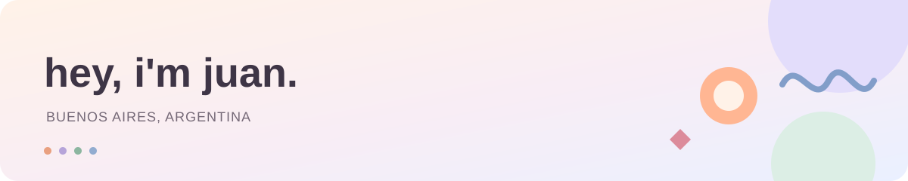

  

I like making things for screens. Sometimes an app, sometimes a small experiment.

🍊 These days, mostly [Buenard](https://buenard.app) — workouts, food, habits,
and a little help from an AI coach.

🧪 Around here you'll also find some experiments with
[AI agents](https://github.com/jvidelac1/clase-7-agentes-por-industria) and
[ways to evaluate them](https://github.com/jvidelac1/clase-8-evaluacion-agentes).

Usually some React, TypeScript, Flutter, or Supabase. Depends on the idea.

[My corner of the internet](https://jcvidela.com) · [Say hi](https://www.linkedin.com/in/jcvidela/)
